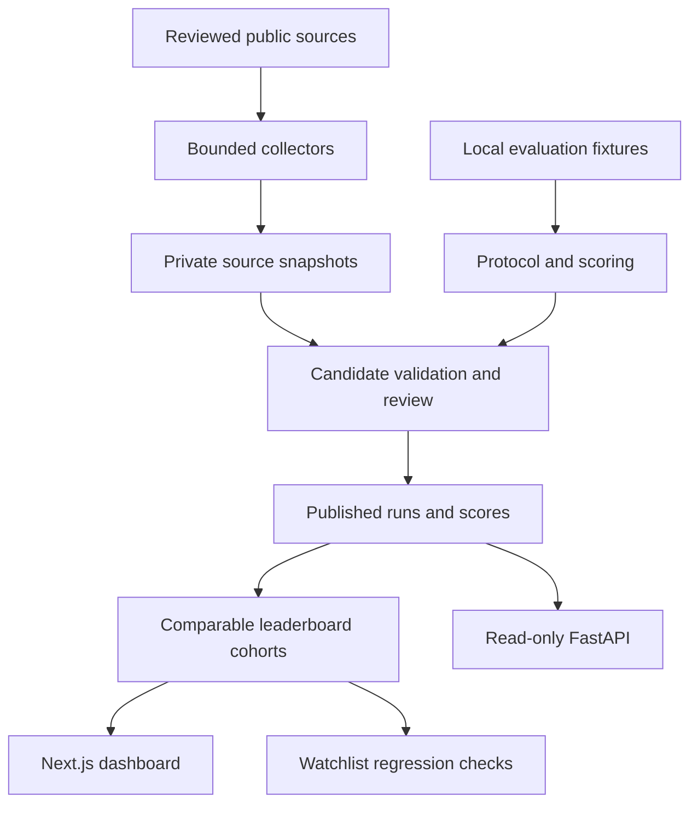

# AgentBench registry architecture

1. Source snapshots retain the URL, retrieval time and a SHA-256 digest over the canonical payload. Collection is allow-listed and deduplicated. Parsed leaderboard candidates stay private until a reviewer can resolve the agent version and confirm the exact protocol.
2. A scored run references the agent version, benchmark, source, dataset split/version, scoring method and declared constraints. Source snapshots and unpublished candidates remain private. The baseline seed maps the existing support demo into published registry runs with pinned code provenance.
3. Public invoker views apply row policies before grouping. A comparison cohort fixes benchmark, metric, dataset version, split, method version, harness, attempt count and constraints. The percentile view also fixes the peer group and uses verified scores only.
4. Postgres leases jobs with a per-claim token and retries expired claims. Workers only handle the implemented, explicitly configured job kinds. Browser and coding fixtures can run locally or in a network-disabled container. The fixture result files are separate from production score publication.
5. The public site uses a Supabase publishable key and read-only policies. Signed-in submissions are visible only to the owner and reviewers. Only configured service-role processes can create published score records. Do not send service keys to the browser or commit them.

## Implementation status

| Stage | Implemented | Remaining |
| --- | --- | --- |
| Schema | Additive migrations, 171 review candidates, run provenance, exact-cohort views, service-only cache, queue leases, submissions, watchlists | Reviewer decisions do not auto-publish scores. Cache refresh is an operator action. |
| Collectors | GitHub metadata, pinned SWE-bench result parser, normalization into private candidates, deduplication, robots checks, daily schedule config | Broader source adapters, recurring infrastructure, automatic weekly discovery, and full seed verification |
| Scoring | Range and direction normalization, Wilson intervals, conservative tie rule, exact comparability, weighted aggregation with unavailable dimensions | Calibrated cross-benchmark dimensions, contamination evidence, and bootstrap intervals |
| UI | Leaderboard, registry and profiles, benchmarks, comparison, peer groups, run evidence, methodology and authenticated review forms | Watchlist UI, fully populated cost and latency datasets, and durable auth session refresh |
| Evaluation | Harness contract, fixed seeds, failure labels, local SWE-bench-style patch and WebArena-style browser fixtures | Official benchmark environments, provider and unrestricted agent adapters, production sandbox fleet, trace storage and OpenTelemetry |
| Alerts/API | Database regression alerts for watched agents, review queue, paginated FastAPI read endpoints with CSV and JSON | Hosted API and worker, distributed limits, competitor-overtake notifications, email delivery and outbound webhooks |

The two reference fixtures use synthetic tasks. They do not publish official benchmark scores. The registry publishes scripted support runs with simulated tool cost and timing. Candidate benchmarks and agents require independent verification before publication.
